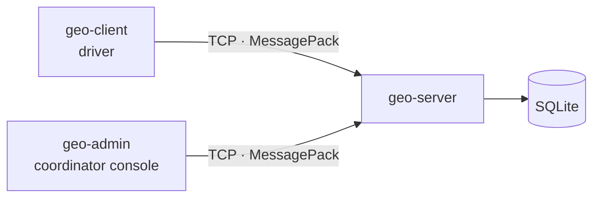

# GeoRuggine

Real-time fleet tracking written in Rust. Drivers stream their position to a server, which reconstructs every trip, stores it and lets a coordinator follow the fleet, request reports and chat with drivers.

## Features

- **Live tracking**: each driver client sends its position every 30 seconds. Positions are emulated: a client can follow a recorded track, drive in a straight line between two points or move randomly around a location.
- **Vehicle states**: disconnected, stopped and moving. A vehicle switches to *stopped* after three minutes without moving, even when its client stops sending data.
- **Reports** for today, this week or this month: distance travelled, average speed, and time spent moving and stopped.
- **Messaging**: broadcasts to every driver, direct messages, and messages from drivers to the coordinator.
- **Accounts** with Argon2-hashed passwords.
- **CPU usage log**: the server records its CPU time to a CSV file every two minutes.
- **Cross-platform**: built and tested on macOS (Apple Silicon) and Windows 11.

## Architecture



The project is a Cargo workspace with three programs and three shared libraries:

| Crate | Role |
| --- | --- |
| `geo-core` | Domain rules: vehicle states, time ranges, distance and speed calculations |
| `geo-protocol` | Network messages and their encoding |
| `geo-net` | Client side of the connection: handshake, login, automatic reconnection |
| `geo-server` | Server: sessions, registry of connected vehicles, database, state evaluator, CPU log |
| `geo-client` | Driver program: movement emulation and terminal UI |
| `geo-admin` | Coordinator console with a terminal UI |

### Design choices

- **Protocol**: every message is length-prefixed and encoded with MessagePack through serde. The first exchange of each connection checks the protocol version and the client's role.
- **Concurrency**: the server runs on Tokio with one task per connection. A single task owns the SQLite database and the others send it requests over a channel, so the database connection is never shared between tasks.
- **Detecting stopped vehicles**: a stopped driver usually sends nothing, so there is no message to react to. A background evaluator re-checks every connected vehicle every 10 seconds and records the moment the three-minute threshold actually expired, not the moment it was noticed.
- **Small binaries**: the release profile optimizes for size (`opt-level = "z"`, LTO, `strip`). On macOS the binaries are 59–67% smaller than with Cargo's default release profile (the server goes from 5.8 MiB to 1.9 MiB).

## Getting started

Requires Rust (the version is pinned in `rust-toolchain.toml`).

```bash
cargo build --release

# Once: create the coordinator account
./target/release/geo-server --create-admin capoflotta --db georuggine.db

# Terminal 1: start the server
./target/release/geo-server --db georuggine.db --log cpu_usage.csv

# Terminal 2: register a driver that follows a sample track
./target/release/geo-client --username camion01 --register --track assets/tracks/demo_camion01.csv

# Terminal 3: open the coordinator console
./target/release/geo-admin --username capoflotta
```

- Use `--register` only the first time a driver connects.
- Other movement modes: `--interpolated "45.06,7.67;45.05,7.71"` (straight line between two points) and `--random "45.07,7.68;5"` (random movement within 5 km).
- To connect to a server on another machine, add `--server <host>:7878`.
- On Windows the executables end in `.exe`.

## Tests

```bash
cargo test
```

Every crate has unit tests, and the server has an end-to-end integration suite.

## Documentation

Detailed documentation (in Italian) is in [`docs/`](docs):

- [User manual](docs/manuale_utente.md): every program and option
- [Developer manual](docs/manuale_sviluppatore.md): how the code is organized and how data flows
- [Technical report](docs/report_descrittivo.md): requirements traceability, performance and portability
- [Database schema](docs/database.md)
- [Project presentation](docs/presentation.pptx)

## Team

- **Francesco Fontana**: domain rules (`geo-core`)
- **Stefano Nuzzo**: server (`geo-server`)
- **Alessandro Demo**: driver client and networking (`geo-client`, `geo-net`)
- **Leonardo Voghera**: coordinator console (`geo-admin`)
